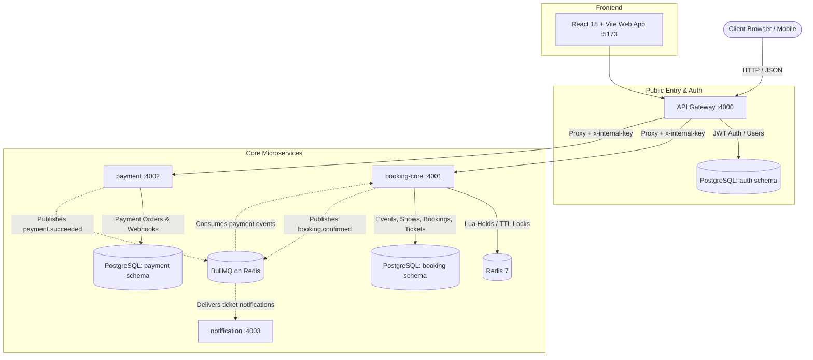

# 🎟️ SeatSnap

A high-concurrency ticket booking platform built with Node.js, Express, TypeScript, PostgreSQL, Redis, and React. Engineered to guarantee that **no seat can ever be double-booked**, even during extreme flash sales with hundreds of simultaneous requests contending for the same seats.

---

## 📸 Demo Walkthrough

### 1. Interactive 3D Arena Seat Selection
* **3D Perspective & 2D Plan**: Switch between a 3D stadium amphitheater with camera pitch/zoom controls and a classic 2D blueprint.
* **Tiered Seating**: Color-coded rows with distinct VIP Stage Front, Premium Center, and Standard Hall pricing.
* **Live Seat Inspector**: Hovering over any seat instantly displays its row, number, tier, and exact price in a fixed inspector bar above the grid—no tooltips obscuring neighboring seats.

### 2. Guaranteed 5-Minute Cart Lock
* Selecting seats and clicking **"Lock & Proceed to Checkout"** executes an atomic multi-seat reservation in Redis.
* A live 5-minute countdown locks the seats exclusively to your session. If payment is not completed before expiry, the sweeper automatically returns the seats to the public pool.

### 3. One-Click Instant Mock Payment & Webhook
* Click **"Pay Now (Instant Mock)"** to simulate an automated payment gateway webhook.
* The backend verifies idempotency, updates status to `CONFIRMED`, and mints cryptographically signed HMAC-SHA256 QR entry passes.

### 4. Digital QR Pass & In-Person Gate Validation
* View confirmed tickets in **"My Tickets"** with high-resolution QR codes.
* Gate staff can scan the QR code via `/api/tickets/validate` to verify signature integrity and atomically check in attendees (preventing pass reuse).

---

## ⚡ Key Features

| Feature | Technical Implementation |
|---|---|
| **Zero Double-Booking Guarantee** | Dual-layer protection: Atomic Redis Lua script holds seats with 5-min TTL, backed by PostgreSQL `uq_active_seat` partial unique constraint. |
| **Dynamic Show Scheduling** | 15 premier events across Music, Comedy, IMAX, and Theatre with 34+ dynamically scheduled upcoming shows (Tonight, Tomorrow, This Weekend). |
| **Live Seat Status Polling** | Frontend short-polls seat availability every 3 seconds via React Query for stateless scalability. |
| **Idempotent Webhook Pipeline** | Payment events are deduplicated by provider event ID (`payment.webhook_events`) to prevent duplicate confirmations on retries. |
| **Asynchronous Event Processing** | BullMQ on Redis decouples payment success from ticket generation and notification delivery. |
| **Cryptographic QR Ticketing** | Each ticket contains an HMAC-SHA256 signed payload (`ticketId:bookingId:seatId:timestamp:signature`) resistant to forgery. |
| **Automatic Hold Expiry Sweeper** | Background sweeper job runs every 30 seconds to reclaim expired pending bookings and release seats. |

---

## 🏗️ System Architecture



### Services Breakdown

| Service | Port | Description | Database Schema |
|---|---|---|---|
| **`gateway`** | 4000 | Public reverse proxy, JWT registration/login, rate limiting, header forwarding | `auth` |
| **`booking-core`** | 4001 | Events, shows, seats, atomic Lua seat holds, bookings, tickets, sweeper | `booking` |
| **`payment`** | 4002 | Payment orders, mock and Razorpay providers, webhook deduplication | `payment` |
| **`notification`** | 4003 | Background queue worker for sending ticket confirmation emails | *None* |
| **`web`** | 5173 | React 18 + Vite client with 3D seat map, live cart lock, and ticket passes | *None* |

---

## 🚀 Quickstart & How to Use

### Prerequisites
* **Node.js**: v20+ LTS
* **Docker & Docker Compose** (for running PostgreSQL and Redis)

---

### Step 1: Clone and Install Dependencies
```bash
git clone https://github.com/your-username/ticket-booking.git
cd ticket-booking
npm install
```

---

### Step 2: Configure Environment Variables
Copy the sample environment file:
```bash
cp .env.example .env
```
*(Default values work out of the box for local development).*

---

### Step 3: Start Services via Docker
Start PostgreSQL, Redis, and all microservices in containers:
```bash
docker compose up --build
```

Alternatively, if you prefer running services locally with your own local Postgres (`localhost:5433`) and Redis (`localhost:6379`):
```bash
# Terminal 1: API Gateway
npm --prefix services/gateway run dev

# Terminal 2: Booking Core
npm --prefix services/booking-core run dev

# Terminal 3: Payment Service
npm --prefix services/payment run dev

# Terminal 4: Frontend Web
npm --prefix web run dev
```

---

### Step 4: Seed the Database
In a separate terminal, run the database seed script:
```bash
npm run seed
```

This populates:
* **Admin Account**: `admin@seatsnap.com` / `AdminPassword123!`
* **Customer Account**: `customer@seatsnap.com` / `CustomerPassword123!`
* **15 Events & 34 Shows**: Dynamically scheduled starting from **Tonight** across Mumbai, Bengaluru, and Delhi.
* **1 Concurrency Benchmark Event**: *"Hot Show Arena"* with 400 seats for load testing.

---

### Step 5: Open the Application
* **Frontend Web App**: [http://localhost:5173](http://localhost:5173)
* **API Gateway**: [http://localhost:4000](http://localhost:4000)
* **Health Check**: [http://localhost:4000/health](http://localhost:4000/health)

---

## 🧪 Testing & Concurrency Benchmarks

### 1. Run Unit & Integration Tests (Vitest)
Executes 26 automated unit and integration tests across services, testing JWT auth, Redis Lua hold atomicity, webhook deduplication, and late payment refund queues:
```bash
npm test
```

### 2. High-Contention Flash-Sale Load Test
Simulates **300 simultaneous hold requests across 50 users** fighting for the exact same 5 seats at the same millisecond:
```bash
npm run loadtest
```
**Expected Outcome:**
* Exactly **1 request succeeds (`201 Created`)**.
* The remaining **299 requests receive `409 Conflict: SEATS_UNAVAILABLE`**.
* **Zero oversells / double bookings.**

### 3. Type Checking & Linting
```bash
npm run typecheck
npm run lint
```

---

## 📡 API Reference

All client requests go through the API Gateway at `http://localhost:4000`:

### Authentication & Users
| Method | Endpoint | Access | Description |
|---|---|---|---|
| `POST` | `/api/auth/signup` | Public | Register with email and password |
| `POST` | `/api/auth/login` | Public | Login and receive JWT bearer token |
| `GET` | `/api/me/bookings` | Customer | List bookings belonging to the authenticated user |

### Events & Shows
| Method | Endpoint | Access | Description |
|---|---|---|---|
| `GET` | `/api/events` | Public | List events (supports `?city=`, `?category=`, `?q=`) |
| `GET` | `/api/events/:id` | Public | Get single event details with all show dates |
| `GET` | `/api/shows/:id/seats` | Public | Real-time seat grid with statuses (`AVAILABLE`, `HELD`, `BOOKED`) |

### Booking & Holds
| Method | Endpoint | Access | Description |
|---|---|---|---|
| `POST` | `/api/shows/:id/hold` | Customer | Atomically hold up to 6 seats for 5 minutes (`{ seatIds: string[] }`) |
| `GET` | `/api/bookings/:id` | Customer | Get booking details, countdown status, and tickets |

### Payment & Webhooks
| Method | Endpoint | Access | Description |
|---|---|---|---|
| `POST` | `/api/bookings/:id/pay` | Customer | Create payment order with configured provider |
| `POST` | `/api/payments/mock/:orderId/complete` | Customer | Developer simulator for instant mock payment completion |
| `POST` | `/api/payments/webhook` | Signature | Production webhook receiver (HMAC signature verified) |

### Tickets & Gate Validation
| Method | Endpoint | Access | Description |
|---|---|---|---|
| `GET` | `/api/tickets/:id/qr` | Customer | Render tamper-proof PNG QR code with HMAC token |
| `POST` | `/api/tickets/validate` | Admin | Scan & cryptographically verify ticket QR, marking it `USED` |

---

## 🔒 Security & Concurrency Defense-in-Depth

1. **Redis Lua Script Atomicity**:
   Checking seat availability and writing the hold keys (`hold:{showId}:{seatId}`) is executed inside an atomic Redis Lua script. Either all requested seats are successfully acquired, or none are.
2. **PostgreSQL Partial Unique Constraint**:
   ```sql
   CREATE UNIQUE INDEX uq_active_seat ON booking.booking_seats (show_id, seat_id)
     WHERE status IN ('HELD', 'CONFIRMED');
   ```
   Even if Redis were to crash or experience cache eviction, the database rejects any concurrent insert with a duplicate active seat, guaranteeing zero data corruption.
3. **Idempotent Webhooks**:
   Incoming payment events are recorded in `payment.webhook_events` using `provider_event_id` as the primary key. Duplicate webhook deliveries are safely acknowledged and skipped.
4. **Late Payment Protection**:
   If a payment succeeds after the 5-minute hold has expired and seats were released, `booking-core` detects the expired status, avoids overselling, and automatically dispatches a `booking.refund_requested` event.

---

## 📄 License
MIT License. Free to use for educational and commercial purposes.
