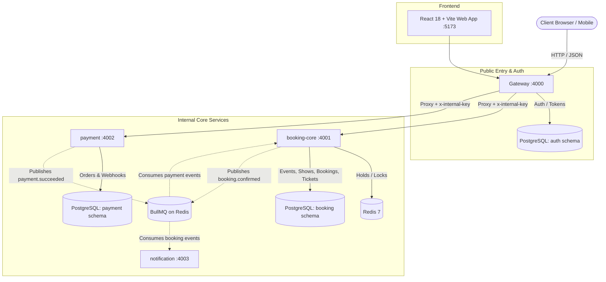
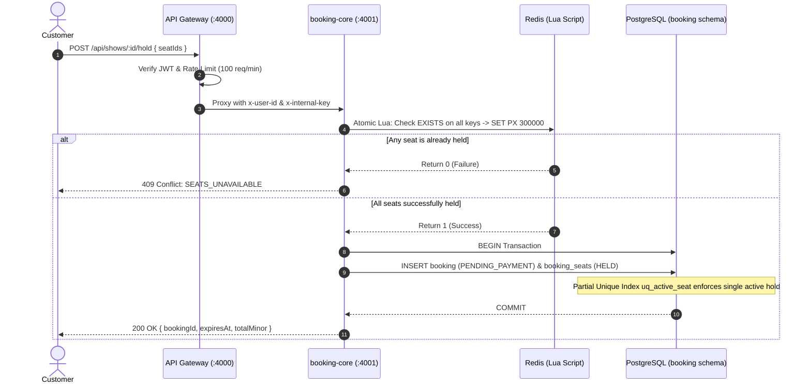

# 🎟️ SeatSnap: High-Concurrency Ticket Booking Platform

> **Core Promise:** The same seat can never be sold twice, even under heavy concurrent load.

SeatSnap is a production-grade ticket booking platform engineered to handle flash-sale ticket demand. It features atomic multi-seat holds with a 5-minute TTL, PostgreSQL partial unique constraints as a hard safety net, an idempotent payment webhook pipeline with BullMQ event queues, and signed HMAC-SHA256 QR ticketing.

---

## 🏗️ Architecture Overview

SeatSnap is structured as an Express + TypeScript monorepo with service isolation over a partitioned PostgreSQL instance and Redis:



### Microservices Summary

| Service | Port | Responsibility | Database Schema |
|---|---|---|---|
| **`gateway`** | 4000 | Public entry point, JWT auth (signup/login), rate-limiting, internal header injection (`x-user-id`, `x-internal-key`) | `auth` |
| **`booking-core`** | 4001 | Events, shows, seats, atomic Lua hold keys, bookings, ticket minting, hold expiry sweeper | `booking` |
| **`payment`** | 4002 | Payment orders, provider abstraction (`MockProvider`, `RazorpayProvider`), idempotent webhooks | `payment` |
| **`notification`** | 4003 | Asynchronous queue consumer for ticket confirmation emails (console/Nodemailer) | *None* |
| **`web`** | 5173 | High-converting React 18 frontend with 3s live polling seat maps and checkout countdown | *None* |

---

## ⚡ Concurrency & Double-Booking Protection Model



---

## 🚀 Quickstart & Local Setup

### Prerequisites
- Node.js 20+ LTS
- Docker and Docker Compose

### 1. Clone & Install
```bash
git clone <repo-url>
cd ticket-booking
npm install
```

### 2. Configure Environment
```bash
cp .env.example .env
```

### 3. Start Infrastructure & Services
```bash
docker compose up --build
```

### 4. Seed Database
In a new terminal window:
```bash
npm run seed
```
This populates:
- 1 Admin (`admin@seatsnap.com` / `AdminPassword123!`)
- 1 Customer (`customer@seatsnap.com` / `CustomerPassword123!`)
- 5 Live Events across Mumbai, Bengaluru, and Delhi with 10x10 seat grids
- 1 "Hot Show" with a 20x20 seat grid (400 seats) for concurrency testing

### 5. Access Services
- **Web App:** [http://localhost:5173](http://localhost:5173)
- **API Gateway:** [http://localhost:4000](http://localhost:4000)
  - Health check: `GET http://localhost:4000/health`
  - Events endpoint: `GET http://localhost:4000/api/events`
  - Signup: `POST http://localhost:4000/api/auth/signup`
  - Login: `POST http://localhost:4000/api/auth/login`

---

## 🧪 Testing

```bash
# Run unit tests
npm test

# Run linter
npm run lint

# Run type check across all workspaces
npm run typecheck
```

---

## 📑 Decisions Log
See [DECISIONS.md](file:///c:/Users/jainp/OneDrive/Desktop/ticket-booking/DECISIONS.md) for rationale behind plain SQL, schema isolation, Lua hold mechanics, and gateway header forwarding.
